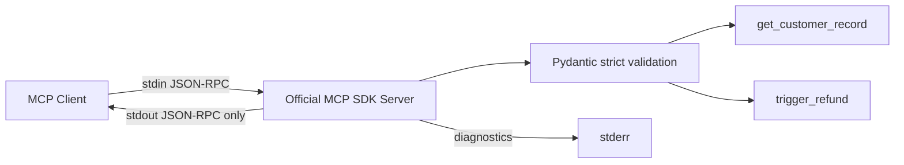
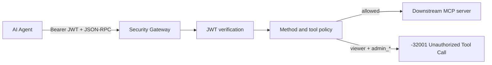
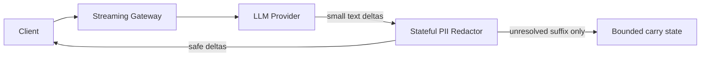
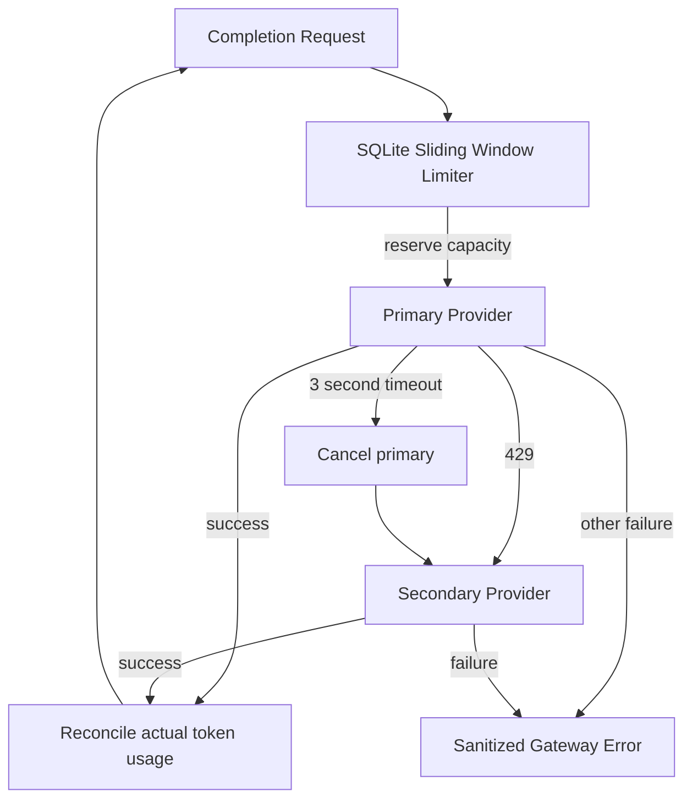

# Architecture

## Task 1: MCP stdio server

The low-level official SDK API is used because this task explicitly requests standard JSON-RPC errors for invalid parameters. Pydantic models generate the advertised JSON Schema and validate runtime arguments. Validation failures are converted to `MCPError` with `-32602`.

## Task 2: MCP security gateway

Authorization is enforced before a downstream request object is created. Tests count downstream calls to prove blocked actions do not escape the gateway.

## Task 3: Streaming PII guardrail

The redactor delays only text that could still become a supported sensitive pattern when a future chunk arrives. It does not collect the entire model response.

## Task 4: Resilient model router

The limiter's check and reservation occur in a single SQLite `BEGIN IMMEDIATE` transaction, which prevents concurrent callers from spending the same remaining budget.
